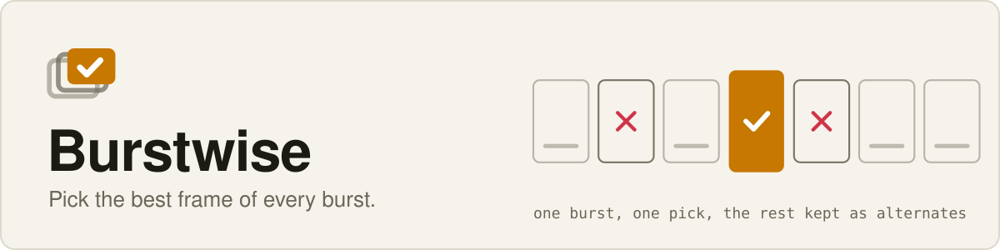
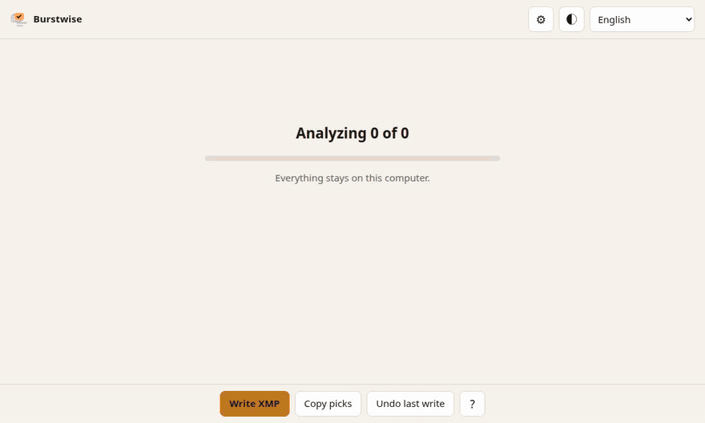

[English](README.md) | [繁體中文](README.zh-TW.md) | [简体中文](README.zh-CN.md) | [日本語](README.ja.md) | **한국어** | [Español](README.es.md) | [Français](README.fr.md) | [Deutsch](README.de.md) | [Português (Brasil)](README.pt-BR.md)

<p align="center">
  <picture>
    <source media="(prefers-color-scheme: dark)" srcset="assets/banner-dark.svg">
    
  </picture>
</p>

<p align="center">
  <a href="https://github.com/Arthur031221/Burstwise/actions/workflows/ci.yml"></a>
  
  
  <a href="https://arthur031221.github.io/Burstwise/"></a>
</p>

<p align="center">
  
</p>

Burstwise는 내 컴퓨터에서 촬영분을 골라 줍니다. 같은 순간을 찍은 사진을 한 그룹으로 묶고, 흔들림, 감은 눈, 노출 날림을 표시하고, 그룹마다 가장 좋은 한 장을 고른 다음, 그 결과를 XMP 별점과 색 라벨로 원본 파일 옆에 기록합니다. 아무것도 업로드하지 않으며 원본은 건드리지 않습니다.

샘플 세트에서 GPU로 **사진 166장을 1.9초** 만에 읽고, 묶고, 판정합니다. CPU만 쓰면 10.5초입니다. 방법과 다른 수치는 [벤치마크](docs/benchmark.md)에 있습니다. [라이브 데모 보기](https://arthur031221.github.io/Burstwise/).

## 적용 전과 후

샘플 폴더는 짧은 영상 네 편에서 잘라 낸 166개 프레임이라 비슷해 보이는 사진이 많습니다. 의도한 구성입니다.

| | 전 | 실행 후 `burstwise cull --write-xmp` |
| --- | --- | --- |
| 순서 | 한 폴더에 파일 166개 | 17개 그룹, 순간마다 하나 |
| 최고의 컷 | 스크롤하며 직접 비교 | 17장 pick, 별점 4와 Green 라벨 |
| 나쁜 컷 | 하나씩 확대해서 찾기 | 15장 reject(감은 눈 9, 흐림 6), 별점 -1과 Red 라벨 |
| 나머지 | 남길 사진과 섞여 있음 | 134장은 alt로 그대로 둠 |
| 이유 | 없음 | 모든 판정에 숫자가 붙은 이유. 예: `soft, 41% of the sharpest frame` |
| 원본 파일 | 안전 | 안전. `.xmp` 파일만 쓰며 `burstwise undo`로 되돌릴 수 있음 |

선별 도구는 근거를 보여 줘야 한다고 생각합니다. 모든 판정에는 읽을 수 있는 이유가 있고, 모든 임계값은 단순한 설정이며, 숨은 점수는 없습니다.

## 빠른 시작

```
pipx install git+https://github.com/Arthur031221/Burstwise
burstwise cull ~/Pictures/shoot              # 계획만 출력하고 아무것도 바꾸지 않음
burstwise cull ~/Pictures/shoot --write-xmp  # 별점과 라벨 기록
burstwise serve ~/Pictures/shoot             # 브라우저에서 확인하고 직접 수정
```

처음 실행하면 합계 약 90 MB인 모델 파일 두 개를 내려받고 SHA-256을 검사합니다.

<details>
<summary>Linux에 설치 (테스트함)</summary>

```
pipx install git+https://github.com/Arthur031221/Burstwise
```

GPU를 쓰려면 `onnxruntime-gpu`가 동작하는 CUDA 12 환경이 필요합니다. 없으면 Burstwise가 알아서 CPU로 돌아가며, `--cpu`를 붙여도 됩니다. NVIDIA GPU가 있는 Ubuntu에서 개발하고 테스트합니다.

</details>

<details>
<summary>macOS에 설치 (테스트 안 함)</summary>

```
pipx install git+https://github.com/Arthur031221/Burstwise
```

macOS에서는 패키지가 CPU용 onnxruntime을 요구합니다. Mac에서 Burstwise를 실행해 본 적이 없으니 아직 시도하지 않은 것으로 봐 주세요.

</details>

<details>
<summary>Windows에 설치 (테스트 안 함)</summary>

```
pipx install git+https://github.com/Arthur031221/Burstwise
```

Windows에서 Burstwise를 실행해 본 적이 없으니 아직 시도하지 않은 것으로 봐 주세요.

</details>

<details>
<summary>소스에서 설치</summary>

```
git clone https://github.com/Arthur031221/Burstwise
cd Burstwise
pip install -e ".[dev]"
```

</details>

## 판정 방식

1. 촬영 시각이 120초를 넘게 벌어지는 곳에서 사진을 장면으로 나눕니다.
2. 같은 장면 안에서 DINOv2 임베딩이 가까운 사진(코사인 유사도 0.80 초과, 평균 연결법)을 한 그룹으로 묶습니다.
3. 사진마다 세 가지를 검사합니다. 얼굴별 MediaPipe 눈 깜빡임 점수, 얼굴의 선명도(그룹에 얼굴 없는 프레임이 있으면 가장 선명한 타일), 하이라이트와 섀도 날림입니다.
4. 그룹 안에서는 눈을 감은 얼굴 수, 다른 문제의 수, 선명도 순으로 순위를 매깁니다. 1위는 pick이고, 자체에 문제가 있으면 review입니다. 나머지는 alt이며 문제가 있으면 reject입니다.

자세한 내용은 [아키텍처](docs/architecture.md)에, 모든 임계값은 [설정](docs/config.md)에 있습니다.

## 기록하는 내용

| 판정 | XMP |
| --- | --- |
| pick | 별점 4, 라벨 Green |
| review | 라벨 Yellow |
| alt | 기록 없음 |
| reject | 별점 -1(거부), 라벨 Red |

사이드카는 덮어쓰지 않고 병합합니다. Lightroom이나 darktable 사이드카에 이미 있는 편집은 그대로 남고, `xmp:Rating`, `xmp:Label`, 그리고 `burstwise:Verdict`와 `burstwise:Reason` 한 쌍만 설정합니다. 다른 프로그램이 쓴 사이드카에 이미 별점(거부 포함)이나 라벨이 있는 사진은 `--overwrite`를 주지 않는 한 건너뜁니다. Burstwise가 전에 쓴 사이드카는 다음 실행에서 그대로 갱신됩니다.

## 확인한 것과 확인하지 않은 것

- 기록한 사이드카를 ExifTool 13.59로 다시 읽어 별점, 라벨, 거부 값을 대조했고 기존 `crs:` 현상 설정이 유지되는지 확인했습니다. 테스트 스위트에 들어 있습니다.
- 사이드카를 Lightroom, Capture One, darktable에서 열어 본 적은 **없습니다**. 표준 XMP이지만 각 프로그램이 어떻게 다룰지는 주장하지 않습니다.
- 정확도는 **측정하지 않았습니다**. 검사는 휴리스틱입니다. 크게 웃거나 눈을 가늘게 뜬 것을 감은 눈으로 볼 수 있고, 선명도로는 초점 흐림과 움직임 흐림을 구분하지 못합니다. 샘플 결과는 눈으로만 확인했습니다.
- 테스트한 것은 Linux뿐입니다. 속도 수치는 한 대의 기계에서 나온 것입니다.
- 그룹화는 사진의 모습과 촬영 시각을 따릅니다. 모습이 비슷하고 장면 간격 안에 있는 서로 다른 순간은 한 그룹이 될 수 있으니, 검토 앱에서 그룹을 확인하세요.
- Adobe와 Aftershoot, Narrative Select 같은 유료 도구에도 선별 기능이 있습니다. Burstwise는 무료로, 로컬에서, 규칙을 읽을 수 있고 표준 XMP를 출력하는 도구를 원하는 사람을 위한 것입니다.

## 문서

- [설치](docs/install.md)
- [사용법과 검토 앱](docs/usage.md)
- [설정](docs/config.md)
- [아키텍처](docs/architecture.md)
- [벤치마크](docs/benchmark.md)
- [기여하기](CONTRIBUTING.md)

검토 앱은 영어, 번체 중국어, 간체 중국어, 일본어, 한국어, 스페인어, 프랑스어, 독일어, 브라질 포르투갈어를 지원하며 다크와 라이트 테마가 있습니다.

## 샘플 데이터

코드는 MIT 라이선스입니다. 샘플 사진은 Creative Commons 영상에서 잘라 낸 프레임이며 [examples/CREDITS.md](examples/CREDITS.md)에 나열되어 있습니다. 이 저장소에는 들어 있지 않고, 일부는 CC BY-SA이므로 재사용할 때 출처 표기를 유지해 주세요.

## 이름에 대해

Burstwise는 만들어 낸 부사형 합성어입니다. burst는 연사로 찍은 프레임 묶음이고, wise는 '현명하게'라는 뜻이며 '연사 하나씩'이라는 어감도 담았습니다.

## 라이선스

MIT. [LICENSE](LICENSE).

Assisted by Claude/Codex.
